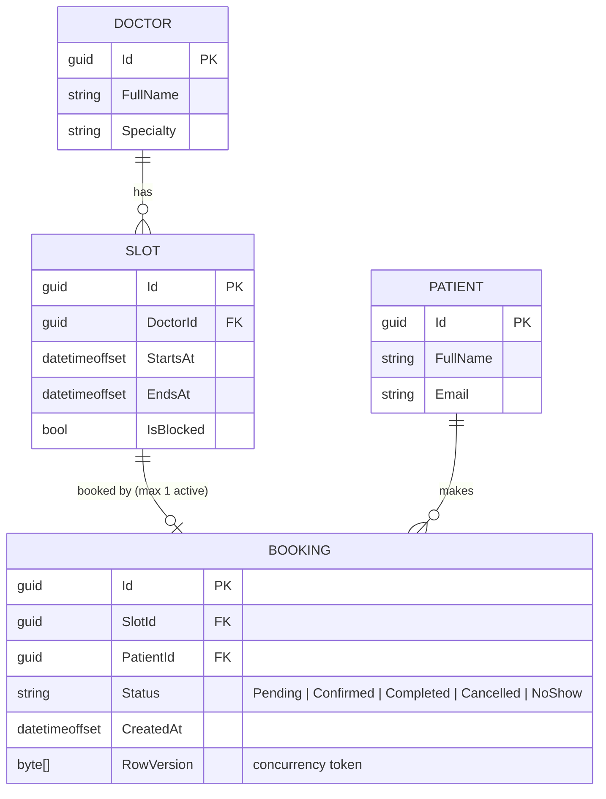

# ClinicBook API

A clinic appointment booking API built with **.NET 10 minimal APIs** to learn and demonstrate industry-standard API design: async/await, dependency injection, concurrency safety, background processing, security, observability and CI.

## Problem

Patients need to book appointments with doctors online. Slots are limited, and two patients must never end up booked into the same slot, even when they click "Book" at the same moment.

## Users

| Role | Can do |
|---|---|
| **Admin** | Manage doctors, view reports |
| **Doctor** | Manage own working hours and slots, view own bookings |
| **Patient** | Browse free slots, book / cancel / reschedule own bookings |

## Core business rule

> **One slot can have at most one active booking.**
> A second attempt to book the same slot returns `409 Conflict`.

## MVP scope

- [ ] Doctors: create, list (paged), get, update, delete
- [ ] Slots: generate from working hours, list free slots by doctor and date
- [ ] Bookings: book, cancel, get, list my bookings
- [ ] Double-booking protection (unique index + concurrency token)
- [ ] Validation errors and all failures returned as ProblemDetails (RFC 9457)
- [ ] OpenAPI 3.1 docs with Scalar UI
- [ ] JWT auth with Admin / Doctor / Patient roles
- [ ] `async` + `CancellationToken` end to end
- [ ] Integration tests, including a parallel double-booking test

### Later (after MVP)

Idempotency keys, background reminders with retries, rate limiting, health checks, structured logging, Docker, GitHub Actions CI, SSE live slot feed, output caching, OpenTelemetry.

### Out of scope

Payments, video consultations, front-end UI.

## Data model



**Key constraints**
- Unique index on `Booking(SlotId)` filtered to active statuses, so the database itself blocks double booking.
- Index on `Slot(DoctorId, StartsAt)` for fast free-slot lookups.
- All times stored in UTC as `DateTimeOffset`.

## Architecture

```
src/
  ClinicBook.Api             -> Program.cs, endpoints, middleware
  ClinicBook.Application     -> services, DTOs, interfaces
  ClinicBook.Domain          -> entities, business rules
  ClinicBook.Infrastructure  -> EF Core, notifiers, HttpClients
tests/
  ClinicBook.Tests           -> xUnit + WebApplicationFactory
```

Dependencies: `Api -> Application -> Domain`, `Infrastructure -> Application`.

## Tech stack

.NET 10 · C# 14 · ASP.NET Core minimal APIs · EF Core · SQL Server (Docker) · xUnit · Testcontainers · GitHub Actions

## Roadmap

| Phase | Branch | Focus |
|---|---|---|
| 0 | `main` | Setup and design (this README) |
| 1 | `feat/setup` | Solution skeleton, OpenAPI, health endpoint |
| 2 | `feat/crud` | Doctors/Slots CRUD, EF Core, DI, validation |
| 3 | `feat/booking-concurrency` | Booking, double-booking protection, idempotency |
| 4 | `feat/background-reminders` | Channel + BackgroundService, keyed DI, resilience |
| 5 | `feat/auth-security` | JWT, roles, rate limiting, versioning |
| 6 | `feat/live-observability` | SSE, health checks, logging, OpenTelemetry |
| 7 | `feat/tests-ci` | Integration tests, Docker, GitHub Actions |

## Running locally

Requires the .NET 10 SDK.

```bash
dotnet restore
dotnet build
dotnet test
dotnet run --project src/ClinicBook.Api
```

Then open:
- API docs (Scalar): http://localhost:5080/scalar/v1
- OpenAPI document: http://localhost:5080/openapi/v1.json
- Liveness: http://localhost:5080/health/live
- System info: http://localhost:5080/api/v1/system/info

`src/ClinicBook.Api/ClinicBook.Api.http` has ready-made requests you can send from VS Code.
